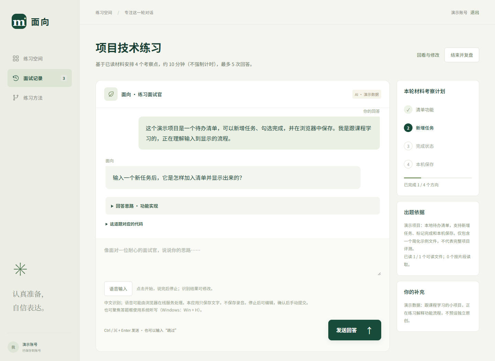
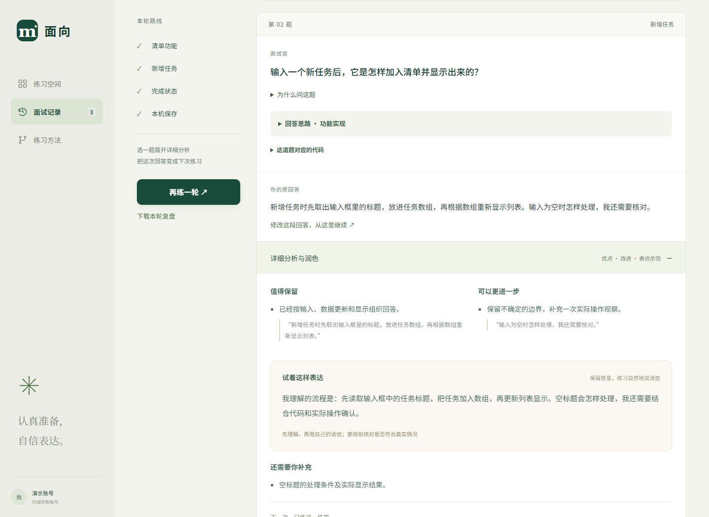
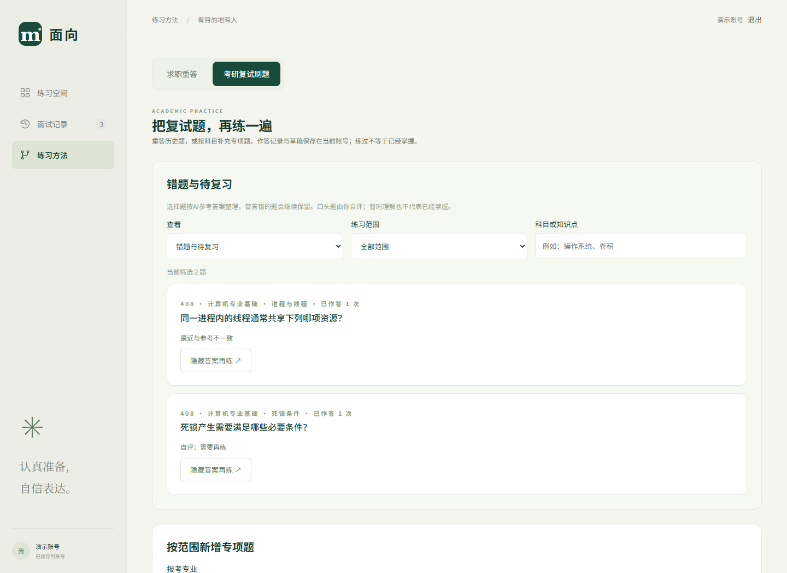

# 面向 · Interview Grove

一个帮助初学者理解项目、练习面试表达的本机 Web 应用。

上传项目代码或简历，结合实际材料开展求职练习；也可以按报考专业和科目范围练习考研复试。回答后查看复盘，再选一道题重新作答，把“看过建议”变成一次具体练习。

**当前版本：1.0.0 · 本机使用版**。源码公开，下载后在自己的电脑上运行，需要使用 AI 功能时配置自己的模型 API。当前没有在线体验站点。

## 可以用它做什么

- **理解自己的项目**：上传项目文件夹，选择整个小项目或负责的模块。问题从整体用途、功能实现逐步深入模块协作与验证，可展开查看对应的代码依据。
- **模拟简历面试**：上传简历图片，选填目标岗位，根据识别出的项目、实习和技能安排问题。
- **练习考研复试**：填写报考专业，选择 408、信号与系统或自定义科目、章节，按范围开展问答。
- **复盘与重答**：查看原回答引用、待验证内容与表达建议；修改回答时保留原记录，也可以只重答一题并比较前后表达。
- **专项刷题**：从复试历史题继续练习，或按范围生成口头题、单选题，通过错题与待复习列表反复练习。
- **保留练习过程**：草稿自动保存，求职和复试记录分开展示，支持单条删除、分支保留和记录下载备份。

项目尤其适合正在学习课程项目、开源移植或 AI 辅助项目的人。练习围绕实际理解展开，不将教程复现描述成独立原创，不将验证设想改写成已经做过的测试。

## 界面预览

以下截图来自应用实际页面，使用独立的演示账号、简化项目和预设问答内容，不包含真实用户记录；用于展示交互，不代表实际模型回答质量或学习效果。

### 练习首页

从求职面试和考研复试两大方向开始，也可以继续上一次练习。


### 项目技术练习

结合读取的项目材料安排问题，展示本轮计划，并提供可展开的回答思路与代码依据。



### 逐题复盘与表达建议

保留原回答，结合引用查看优点、改进方向和表达示范，也可以从这一题创建修改分支。



### 复试错题与待复习

按练习范围和知识点筛选题目，保留错题与口头题自评，隐藏答案后再练一次。



## 快速开始

### 1. 准备环境

需要 Node.js。建议使用 **Node.js 22.13+ 的 22.x 版本，或更新的 LTS 版本**，以便直接使用内置的 `node:sqlite`。旧版本若提示找不到该模块，请升级 Node.js。版本说明见 [Node.js SQLite 文档](https://nodejs.org/api/sqlite.html)。

前后端使用原生 JavaScript 和 Node.js，数据库使用内置 SQLite，**没有第三方运行依赖，无需执行 `npm install`**。

### 2. 获取源码并启动

可以点击仓库的 **Code → Download ZIP** 下载解压，也可以使用 Git：

```sh
git clone https://github.com/QLUlq/interview-grove.git
cd interview-grove
npm start
```

打开 **http://localhost:3001**。服务默认只监听本机地址；保持启动它的终端运行，使用结束后按 `Ctrl + C` 停止。

没有配置模型密钥时，可以先体验考研的预设规则练习。项目源码读取、简历识别和 AI 复盘等功能需要完成下面的配置。

### 3. 配置 AI 功能

将项目根目录的 `.env.example` 复制为 `.env`，用文本编辑器填写自己的配置：

```dotenv
INTERVIEW_API_KEY=填写你自己的模型服务密钥
INTERVIEW_BASE_URL=填写兼容接口的基础地址
INTERVIEW_MODEL=填写可用的模型名称
PORT=3001
```

- 接口需要兼容 Chat Completions，并支持 JSON 输出。配置文件中的默认示例可作为字段格式参考，模型可用性与费用以所用服务商为准。
- 使用简历图片识别时，需要支持图片和 JSON 输出的视觉模型，可通过 `INTERVIEW_VISION_MODELS` 指定。
- 文本备用模型可通过 `INTERVIEW_FALLBACK_MODELS` 设置，多个名称用英文逗号分隔。仅明确的额度耗尽错误会触发候选切换，图片请求不会转交纯文本备用模型。
- 保存配置后重启服务，再刷新页面。请勿把 `.env`、真实密钥或个人材料提交到仓库。

使用 AI 时，选中的源码片段、简历图片、补充信息或回答会按功能需要发送给你配置的模型服务。请先移除无权分享的代码、凭据和个人信息；应用的过滤不能保证去除全部敏感内容。

## 推荐的第一次练习

1. 选择一个自己正在学习的小项目，或先使用复试预设范围体验规则问答。
2. 项目练习先核对读取范围和识别结果，明确说明教程、开源移植或 AI 辅助等背景。
3. 用自己的话回答；不确定的地方可以直接说不清楚，查资料期间不会因计时被强制结束。
4. 结束后查看复盘，选择一个具体问题重答，再比较两次回答的差异。

项目练习的 10 / 20 / 30 分钟用于安排 4 / 6 / 8 个主要考察点，最多 5 / 8 / 11 次回答，并非强制倒计时。复试按所选范围安排问题，题量规则与项目练习不同。

## 数据保存与隐私

- **访客**：记录保存在当前浏览器、当前站点的 localStorage 中。清理浏览器站点数据会影响这些记录。
- **本机账号**：记录保存在本机 `data/interviews.sqlite`。账号与访客空间独立，登录后可手动复制本浏览器的访客记录，没有跨设备云同步。
- **备份**：应用内可下载 JSON 留存；当前没有通用 JSON 恢复入口。迁移整个账号数据库时，先停止服务，再复制整个 `data/` 目录。
- **仓库内容**：不包含作者的密钥、账号、简历、项目上传材料或练习记录。每位使用者需要自行配置模型服务。
- **跨用户经验汇总**：默认关闭。开启后仅汇总符合参与账号数量门槛的固定标签，不共享其他账号的原话、源码、简历或身份，不训练模型。

模型密钥在本机服务端读取，不放入前端页面。数据库中的练习内容未加密，请自行保护本机数据及备份。

## 当前限制

- **AI 内容需要核对**：题目、参考答案和润色可能有误。结构与引用校验不能证明技术结论正确；完成练习或自评也不代表已经掌握。
- **只读取部分项目材料**：最多 80 个文件、约 11 万字符，会显示读取与省略范围，不声称完整理解整个仓库。
- **复试预设用于练习**：408、信号与系统不代表某所学校的最新考纲或真题，应按目标院校公布的科目和章节填写范围。
- **语音是辅助输入**：Windows 优先使用本机中文离线引擎，但技术词和普通句子均可能误识别。没有可用引擎时可能使用浏览器识别服务，具体处理方式会在页面提示；也可以使用键盘或 Windows 系统听写。识别后需核对并手动提交。
- **不保证免费调用**：应用无法查询实时免费余额。是否免费、额度期限以及“用完即停”设置取决于服务商；配置备用模型不会自动获得免费额度。
- **定位为本机应用**：尚未提供公网服务、密码找回或生产环境部署能力，公开源码不等于在线运行。

## 技术与验证

前端使用原生 JavaScript、HTML 和 CSS；后端使用 Node.js HTTP 服务；本机账号数据使用 SQLite。项目在 **AI 编程工具辅助下完成**，使用现有模型 API，没有训练或微调模型，也没有使用向量数据库。

```sh
npm test
```

1.0 收尾时 **111 项自动测试通过**，覆盖会话推进、题量约束、输出校验、账号保存与冲突、分支、刷题记录、模型切换和语音取消等逻辑。另做过部分真实模型小请求和浏览器流程验证。测试通过不代表面试质量、参考答案正确率或真人语音准确率已经得到全面评测。

## 目录与文档

- `public/`：页面、练习流程和前端模块。
- `server.mjs`：本机 HTTP 服务与接口。
- `model.mjs`、`model-routing.mjs`：模型调用、输出校验与候选切换。
- `store.mjs`：账号、SQLite 数据和记录校验。
- `local-speech.mjs`、`scripts/`：Windows 本机语音识别。
- `test/`：自动测试。
- `docs/`：补充说明。

可继续阅读 [功能与实现细节](docs/FEATURES.md)、[版本说明](docs/RELEASE.md)、[历史设计记录](docs/DESIGN.md)和[项目讲解与问答](docs/INTERVIEW_GUIDE.md)。

## 反馈问题

欢迎通过 [Issues](https://github.com/QLUlq/interview-grove/issues) 反馈问题或建议。请说明操作步骤、预期结果和实际现象；截图及日志请先脱敏，不要附带密钥、真实简历、完整练习记录或未获授权的源码。
